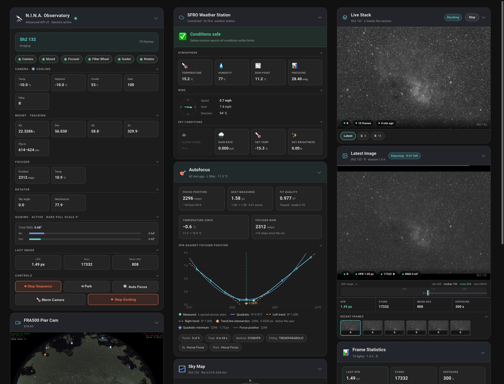
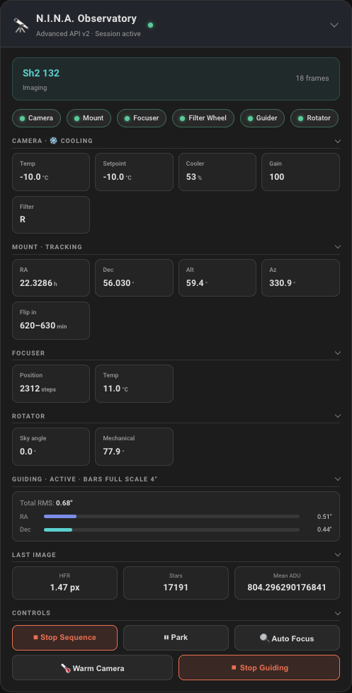
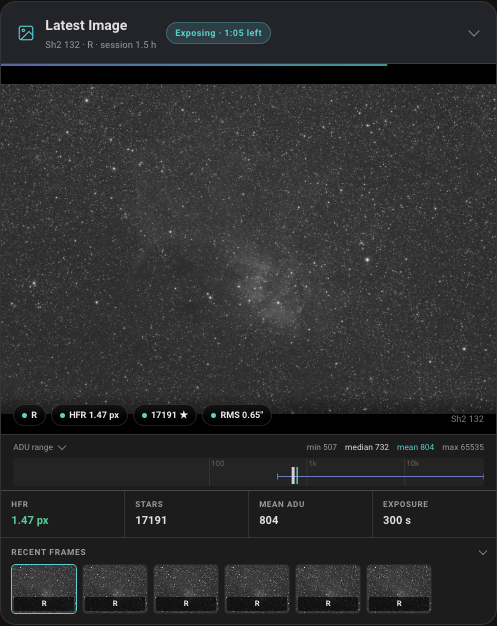
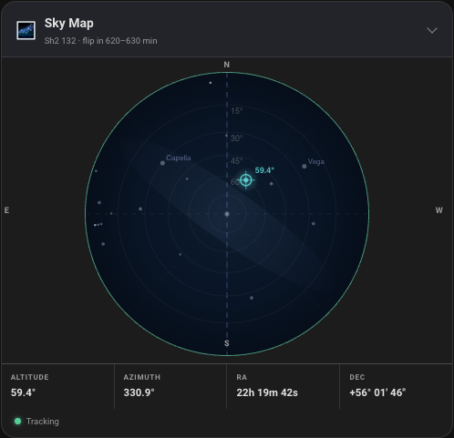
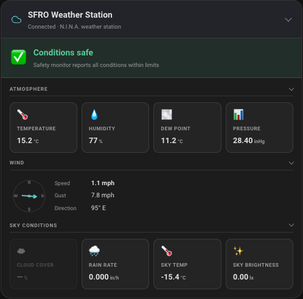
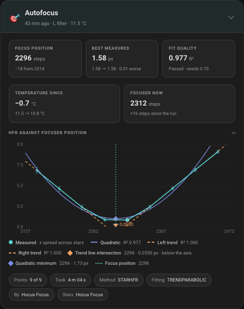
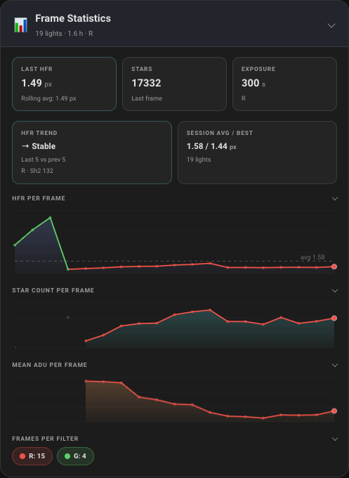
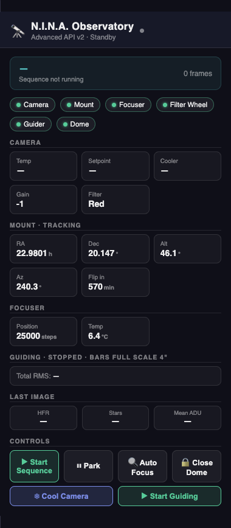

# N.I.N.A. Astrophotography – Home Assistant Integration

Monitor and control a [N.I.N.A.](https://nighttime-imaging.eu) imaging rig from
Home Assistant. N.I.N.A. (Nighttime Imaging 'N' Astronomy) is free, open-source
astrophotography software for Windows that runs the camera, mount, focuser,
filter wheel and guider, and captures images through automated sequences. This
integration talks to it through N.I.N.A.'s
[Advanced API plugin](https://github.com/christian-photo/ninaAPI).

It provides:

- sensors for the camera, mount, focuser, guider, weather and the current
  session
- buttons and actions to cool, slew, park, focus and run sequences
- Home Assistant events for everything N.I.N.A. reports
- six dashboard cards
- six automation blueprints



This is a maintained fork of
[C3X0Astro/homeassistant-nina-astrophotography](https://github.com/C3X0Astro/homeassistant-nina-astrophotography),
which is no longer updated.

**Upgrading from 1.4.x?** Follow [the upgrade guide](docs/upgrading-to-2.0.md)
first.

## Requirements

- **N.I.N.A. 3.2.0.9001 or later** on the imaging PC, which the plugin below
  requires.
- **The Advanced API plugin 2.2.15.x**, installed from N.I.N.A.'s **Plugins**
  tab and enabled under **Options → Advanced API**. Note its port (default
  `1888`). The integration uses the plugin's v2 API, and is tested with
  N.I.N.A. 3.2.0.9001 and the plugin 2.2.15.2.
- **Home Assistant 2026.9.0 or later.**
- **A network path from Home Assistant to the imaging PC on that port.** Home
  Assistant both polls it over HTTP and holds a WebSocket open on it, so the
  Windows firewall must allow inbound connections on the port.

The Advanced API's 3.0 pre-releases, which need N.I.N.A. 3.3, are untested.
Their optional authentication and SSL are not supported: the integration
connects over plain HTTP and sends no credentials, so leave both off.

> [!WARNING]
> The Advanced API 2.2.15 has no authentication. Anything that can reach the
> port can move your mount. Keep it on your LAN or a VPN, never exposed to the
> internet.

## Installation

### From the Marketplace (Home Assistant 2026.11 or later)

[](https://my.home-assistant.io/redirect/marketplace_repository/?owner=dgivens&repository=homeassistant-nina-astrophotography&category=integration)

1. Click the badge above. It opens this repository in your Home Assistant's
   **Settings → Marketplace**. If your Marketplace doesn't list the repository
   yet, it offers to add it as a custom repository first; accept. Adding a
   custom repository needs the Marketplace's GitHub connection.
2. Install **N.I.N.A. Astrophotography**. A first install loads straight away,
   with no restart.
3. Continue with [Setup](#setup).

### With HACS (Home Assistant 2026.9 and 2026.10)

1. In HACS, open the **⋮** menu → **Custom repositories**.
2. Enter `https://github.com/dgivens/homeassistant-nina-astrophotography`, choose
   type **Integration**, and click **Add**.
3. Search HACS for **N.I.N.A. Astrophotography** and click **Download**.
4. Restart Home Assistant.
5. Continue with [Setup](#setup).

Upgrading Home Assistant to 2026.11 moves this install into the Marketplace
along with the rest of HACS.

### Manually

1. Download the latest
   [release](https://github.com/dgivens/homeassistant-nina-astrophotography/releases)
   and copy its `custom_components/nina_astrophotography` folder into your Home
   Assistant config directory, so you end up with
   `config/custom_components/nina_astrophotography/`.
2. Restart Home Assistant.
3. Continue with [Setup](#setup).

### Updating

The Marketplace (or HACS) offers each new release as an update. Updating a
loaded integration takes effect after a restart; the Marketplace raises a
repair with a restart button. Update a manual install by replacing the folder
and restarting.

## Setup

[](https://my.home-assistant.io/redirect/config_flow_start/?domain=nina_astrophotography)

1. Go to **Settings → Devices & Services → Add Integration** and choose
   **N.I.N.A. Astrophotography**, or click the badge.
2. Enter the [setup fields](#setup-fields). Home Assistant checks that the
   Advanced API answers before it creates the entry.
3. Add one entry per rig.

Equipment shows up as devices the first time N.I.N.A. reports it connected, so
expect devices to appear as your sequence connects things.

## Configuration

### Setup fields

Asked once, when you add the rig. To change the host, port or instance name,
delete the entry and add it again.

| Field | Default | Meaning |
|---|---|---|
| **Host / IP Address** | — (required) | The imaging PC's IP address or hostname. |
| **API Port** | `1888` | The Advanced API plugin's port, as set under **Options → Advanced API** in N.I.N.A. |
| **Instance Name** | `N.I.N.A.` | Names the rig. It titles the entry, names the hub device and prefixes every entity id (`N.I.N.A.` gives `sensor.n_i_n_a_…`), so choose it before you build dashboards. Each rig needs its own name. |

The same host and port can't be added twice, whatever the host's letter case;
the same host on another port is a separate rig.

### Options

Under **Settings → Devices & Services → N.I.N.A. Astrophotography →
Configure**. Saving reloads the entry.

| Option | Default | Range | Meaning |
|---|---|---|---|
| **Session Rollover Hour** | 12 | 0–23 | The hour, on the imaging PC's clock, where one session ends and the next begins. If that clock runs UTC, set it to a real midday on site, or a night's statistics split in two. |
| **Outage Grace Period** | 30 s | 0–300 s | How long N.I.N.A. may stop answering before its entities go `unavailable`. Until then they keep their last values. `0` marks them unavailable on the first failed poll. `binary_sensor.<instance>_reachable` turns `off` at once either way. |

## Data updates

- **Push.** The integration holds a WebSocket open to the Advanced API, and
  most changes reach the entities as soon as N.I.N.A. reports them.
- **Poll.** Equipment state is also read every 10 seconds, as a backstop for
  anything the event stream doesn't carry. The interval is fixed. For a
  different cadence, turn off **Enable polling for changes** under the entry's
  **⋮ → System options**, and call `homeassistant.update_entity` on one of the
  rig's entities from an automation; each call requests one poll. Pushed changes
  keep arriving either way.
- **Slower reads.** The loaded sequence is read every 30 s while the rig is
  imaging and every 5 minutes otherwise, and when a sequence starts or
  finishes.
  Flat-run status, Livestack status, the N.I.N.A. profile and the last
  autofocus run are read every 5 minutes. These ride on the poll, so with
  polling turned off they are read only when a poll runs.
- **Reconnects.** When the WebSocket drops, the integration reconnects,
  re-reads the image history so a frame saved during the drop still counts,
  and replays N.I.N.A.'s event history into the entities. The replayed events
  are not fired again as Home Assistant events.
- **Outages.** If N.I.N.A. stops answering, entities keep their last values for
  the **Outage Grace Period** (default 30 s), then go `unavailable`.
  [The reference](docs/reference.md#availability) has the detail.

## Read this before writing automations

- **`binary_sensor.<instance>_safety_monitor_unsafe` is `on` when it is
  unsafe.** Trigger an abort on `to: "on"`. An automation triggering on
  `"off"` fires when the sky clears.
- **Don't use weather sensors as a safety source.** Forecast-based sources can
  report clear skies under cloud. Abort on the safety monitor; use weather
  only to decide whether to resume.
- **A disconnected device's entities become `unavailable`, not `off`.**
- **`mount_slew` takes J2000 coordinates in degrees.** Catalogues give RA in
  hours: multiply by 15. Don't feed it the mount RA sensor, which reports hours
  in the mount's own epoch.
- **Actions return when N.I.N.A. accepts the command,** not when the equipment
  finishes. Wait on the entities if you need to know it's done.
- **`sequencer_running` and `imaging` are different.** The sequencer stays
  running while it waits for darkness or safe conditions; `imaging` is only on
  while frames are being taken.
- **Sessions roll over at noon on the imaging PC's clock.** If that clock runs
  UTC, change the hour under **Configure** on the integration, or nights will
  be split in two.

[docs/reference.md](docs/reference.md) has the full behaviour of every entity:
sessions, flats, autofocus, weather, stall detection, and the attributes
available for your own cards.

<a id="lovelace-cards"></a>

## Dashboard cards

The integration installs six cards and registers them with Home Assistant
automatically. To add one:

1. Open a dashboard and click **Edit dashboard** (the pencil icon).
2. Click **Add card** and search for **N.I.N.A.**.
3. Pick a card. With one rig, it works without any configuration. With two,
   pick the rig in the card's **N.I.N.A. instance** field.

Or, in a card's YAML editor:

```yaml
type: custom:nina-observatory-card
```

| Card | Shows | Options (all optional) |
|---|---|---|
| `custom:nina-observatory-card` | Session summary, equipment status, meridian countdown, camera/mount/focuser readings, guiding, last frame, and controls. Stop, park, and opening or closing the dome ask for confirmation; Open Dome is disabled unless the safety monitor reads safe. | — |
| `custom:nina-frame-stats-card` | HFR, star count and ADU trends for the session's frames, and a per-filter breakdown | — |
| `custom:nina-autofocus-card` | The last autofocus run: measured points, fitted curves, final position, and whether it passed your R² threshold | `temperature_delta`: flag when the focuser has drifted this many °C since the run (default: your sequence's "AF After Temperature Change" trigger, else 2) |
| `custom:nina-image-panel-card` | The latest frame, recent frames, and their statistics | `refresh_on_save`, `stretch`, `show_histogram`, `show_strip` (all default `true`); `strip_count` (default 6, max 20); `quality` (JPEG, default 85) |
| `custom:nina-sky-map-card` | A star chart with the telescope's pointing, recent positions and the meridian | `trail_length` (default 60); `map_size` in px (default 320); `latitude` to override the site |
| `custom:nina-weather-card` | Safety status, weather and sky quality | Its warning and danger limits, in °C and m/s whatever unit a reading is shown in: `dew_margin` (default 3); `temperature_high` and `temperature_low` (25, −10); `wind_warn` and `wind_danger` (8, 12); `humidity_warn`/`_danger` (85, 95) and `cloud_warn`/`_danger` (60, 85) in %; `seeing_warn`/`_danger` (3, 5) in arcsec. `show_sky_brightness: false` leaves out the sky brightness cell, for a station that measures only whole lux and reads 0 all night. A reading whose entity is disabled, or that the station never reports, has no cell |

| Observatory | Latest image | Sky map |
|:-:|:-:|:-:|
|  |  |  |
| **Weather** | **Autofocus** | **Frame statistics** |
|  |  |  |

With a dome, the observatory card adds a Dome chip and Open or Close Dome:



Every card also accepts:

- `device_id`: which rig to show, when you have more than one. Use the
  visual editor's picker rather than typing an id.
- `prefix`: only needed if you renamed the instance and some readings are
  blank. Set it to the start of your entity ids, e.g. `my_rig` for
  `sensor.my_rig_mount_altitude`.

Cards show readings in the units Home Assistant is set to use. Camera
temperatures are conventionally in °C in astrophotography software, so on a
US customary system you may want to set °C as the display unit for the camera
temperature entities.

If your dashboard resources are managed in YAML (`resource_mode: yaml`, or
`mode: yaml` without `resource_mode`), the integration can't register the
cards. It logs the six entries to add; each looks like this:

```yaml
lovelace:
  resources:
    - url: /nina_astrophotography_static/nina-observatory-card.js
      type: module
```

## Blueprints

To add one, go to **Settings → Automations & Scenes → Blueprints → Import
Blueprint** and paste its URL from the table. Then click **Create automation**
on the imported blueprint and pick your rig's entities.

| Blueprint | What it does |
|---|---|
| [Unsafe conditions abort](https://github.com/dgivens/homeassistant-nina-astrophotography/blob/main/blueprints/automation/nina_astrophotography/weather_abort.yaml) | When the safety monitor reports unsafe or stops reporting: stop the sequence, park, warm the camera and, if you enable it, close the dome once the mount confirms park — given the shutter status, it alerts if the dome does not close. Can resume when conditions clear. Notifies when N.I.N.A. itself stops answering, soonest with the rig's Reachable sensor. |
| [Session startup](https://github.com/dgivens/homeassistant-nina-astrophotography/blob/main/blueprints/automation/nina_astrophotography/session_startup.yaml) | At a set time, if the safety monitor reads safe: unpark, optionally open the dome, cool the camera and wait out the ramp, check safety again, then load a named sequence (or keep the loaded one) and start it. It leaves tracking to the sequence's first slew. |
| [Session shutdown](https://github.com/dgivens/homeassistant-nina-astrophotography/blob/main/blueprints/automation/nina_astrophotography/session_shutdown.yaml) | At a set time, first waits up to two hours for the sequence to finish (on by default), then stops it if it's still running, parks, optionally closes the dome over a parked mount — alerting if it does not close — and warms the camera. |
| [Meridian flip warning](https://github.com/dgivens/homeassistant-nina-astrophotography/blob/main/blueprints/automation/nina_astrophotography/meridian_flip_warning.yaml) | Notifies before a meridian flip, when it starts, and when it finishes. |
| [Guiding alert](https://github.com/dgivens/homeassistant-nina-astrophotography/blob/main/blueprints/automation/nina_astrophotography/guiding_alert.yaml) | Notifies, and optionally runs autofocus, when guiding RMS stays high. |
| [Imaging stall alert](https://github.com/dgivens/homeassistant-nina-astrophotography/blob/main/blueprints/automation/nina_astrophotography/imaging_stall_alert.yaml) | Notifies when frames stop for a bad reason (N.I.N.A. unreachable, mount parked mid-sequence, no frames), and clears when they resume. [Details](docs/reference.md#the-imaging-stall-alert-blueprint). |

Alternatively, copy the `blueprints/automation/nina_astrophotography/` folder
into `config/blueprints/automation/` and reload automations.

## Actions

Call these from automations, scripts, or **Developer Tools → Actions**. All are
in the `nina_astrophotography` domain. Each returns when N.I.N.A. accepts the
command, not when the equipment finishes.

| Action | Does |
|---|---|
| `camera_cool` | Cool the camera sensor to a target temperature |
| `camera_warm` | Warm the camera sensor back to ambient |
| `camera_capture` | Take one exposure |
| `camera_abort_capture` | Abort the current exposure |
| `mount_slew` | Slew to J2000 coordinates |
| `mount_park` / `mount_unpark` | Park / unpark the mount |
| `mount_set_tracking` | Turn sidereal tracking on, or stop tracking |
| `focuser_move` | Move the focuser to an absolute position |
| `focuser_auto_focus` | Run an autofocus with N.I.N.A.'s configured method, outside the sequence |
| `filterwheel_change_filter` | Change filter |
| `guider_start` / `guider_stop` | Start / stop guiding |
| `dome_open` | Open the dome shutter; refused while the safety monitor reports unsafe |
| `dome_close` / `dome_park` | Close the shutter / park the dome. Whether parking also closes the shutter is up to the dome's driver |
| `sequence_load` | Load a sequence, without starting it |
| `sequence_start` / `sequence_stop` | Start the loaded sequence / stop the running one |

### Fields

Actions not listed here take no fields.

| Action | Field | Required | Default | Range | Meaning |
|---|---|---|---|---|---|
| `camera_cool` | `temperature` | yes | — | −50 to 50 °C | Target sensor temperature. |
| `camera_cool` | `minutes` | no | the profile's ramp | 0 or more, in minutes | The shortest time to ramp to the target over. Omitted, N.I.N.A. uses the ramp its profile sets for the camera. |
| `camera_warm` | `minutes` | no | the profile's ramp | 0 or more, in minutes | The shortest time to ramp back to ambient over. Omitted, as for `camera_cool`. |
| `camera_capture` | `duration` | yes | — | 0 up to the camera's maximum exposure | Exposure length, in seconds. Nothing raises a short value to the camera's minimum, so what `0` does is up to the camera's driver. |
| `camera_capture` | `gain` | no | the camera's default | 1 or more, within the camera's gain range | Gain for this exposure. `0` is refused, since the plugin would ignore it and capture at the default. |
| `camera_capture` | `save` | no | `false` | — | Save the frame to disk on the imaging PC. |
| `mount_slew` | `ra_degrees` | yes | — | 0–360° | J2000 right ascension, in **degrees**. A catalogue RA in hours × 15. |
| `mount_slew` | `dec_degrees` | yes | — | −90 to 90° | J2000 declination. |
| `mount_set_tracking` | `enabled` | yes | — | — | `true` tracks at the sidereal rate; `false` stops tracking. |
| `focuser_move` | `position` | yes | — | 0 or more steps | Absolute focuser position. The API reports no maximum, so travel beyond the focuser's is left to N.I.N.A. and its driver. |
| `filterwheel_change_filter` | `filter_index` | yes | — | one of the wheel's slots | **Zero-based** slot: the first filter is `0`. |
| `guider_start` | `force_calibration` | no | `false` | — | Calibrate before guiding starts. |
| `sequence_load` | `sequence_name` | yes | — | — | The sequence's name as N.I.N.A. lists it, without the `.ninasequence` extension. Not a path. |

Out-of-range values are rejected with an error rather than sent to N.I.N.A.,
which would silently clamp them. That holds for the fixed limits above and for
the ranges the connected equipment reports: the camera's maximum exposure and
its gain range, and the filter wheel's slots. Equipment that reports no range,
or is disconnected, leaves the value to N.I.N.A., as does the focuser's upper
limit. There is no dither action; the API doesn't provide one.

```yaml
- alias: "Cool the camera before sunset"
  triggers:
    - trigger: sun
      event: sunset
      offset: "-00:30:00"
  actions:
    - action: nina_astrophotography.camera_cool
      data:
        temperature: -10
        minutes: 15
```

### Two rigs

Every action takes a target: an entity, device, area, floor or label of this
integration. **The target is optional while one rig is configured, and
required once a second is**: an untargeted call is then refused. Any device of
the rig works (its hub or any of its equipment), as does one of its entities
or an area, floor or label holding one. The visual action editor gives you a
picker; in YAML, use `target: {device_id: …}` or `data: {device_id: …}`, where
the device id is the last part of the device page's URL.

```yaml
actions:
  - action: nina_astrophotography.mount_park
    target:
      device_id: 0123456789abcdef0123456789abcdef   # the east rig's hub
  - action: nina_astrophotography.mount_park
    target:
      device_id: fedcba9876543210fedcba9876543210   # the west rig's hub
```

## Events

Every event N.I.N.A. sends while the connection is up becomes a Home Assistant
event: `IMAGE-SAVE` fires `nina_image_save`, `MOUNT-AFTER-FLIP` fires
`nina_mount_after_flip`, and so on. Every one also fires as `nina_event`.
Events N.I.N.A. sent while the connection was down still update the entities
once it reconnects, but are not fired as Home Assistant events.

| Field | Contains |
|---|---|
| `event` | the N.I.N.A. event name, e.g. `IMAGE-SAVE` |
| `time` | when it happened (ISO 8601) |
| `instance` | the instance name |
| `entry_id` | the config entry id, to tell two rigs apart |
| `data` | the event's plain fields, using N.I.N.A.'s names. Nested objects and lists are left out, so `nina_filterwheel_changed` carries no `Previous` or `New` filter: read the filter sensor instead |
| `frame` | frame statistics on `IMAGE-SAVE`, otherwise `null` |

`frame` holds `date`, `filename`, `target_name`, `filter_name`, `image_type`
(`LIGHT`, `FLAT`, `DARK`, `BIAS`, …), `exposure_time` (s), `hfr`, `stars`,
`mean`, `median`, `std_dev`, `min`, `max`, `rms_arcsec`, `temperature`,
`gain`, `offset`, `focal_length` and `generation` (when the N.I.N.A. process
that saved it started). `hfr` and `stars` are `null` on flat,
dark and bias frames, and on a light frame with no stars measured, so give
them a default in a template:

```yaml
- alias: "Report each saved light frame"
  triggers:
    - trigger: event
      event_type: nina_image_save
  conditions:
    - condition: template
      value_template: "{{ trigger.event.data.frame.image_type == 'LIGHT' }}"
  actions:
    - action: notify.mobile_app_myphone
      data:
        message: >
          HFR {{ trigger.event.data.frame.hfr | round(2, default='–') }},
          {{ trigger.event.data.frame.stars | default('no', true) }} stars
```

`nina_websocket_connected` and `nina_websocket_disconnected` fire when the
event connection to N.I.N.A. comes up or drops. They carry only `instance` and
`entry_id` from the table above, and do not fire as `nina_event`. `connected`
also fires on the first connect after setup, and `disconnected` also fires
when the instance is unloaded while connected.

`event.<instance>_error` records plate-solve failures, camera download timeouts
and autofocus timeouts. It misses some errors; see
[Known limitations](#known-limitations).

## Known limitations

- **No dither action.** The Advanced API has no dither command.
  `nina_guider_dither` does fire, but N.I.N.A. raises it even for a dither it
  skipped, so it doesn't prove one happened.
- **Error events are partial.** N.I.N.A. finds plate-solve failures by matching
  ASTAP's log lines, so other solvers' failures don't appear, and its own
  autofocus error event doesn't fire; `autofocus_timeout` is this
  integration's own check. [Details](docs/reference.md#error-events).
- **The flat sensors see only API-started flats.** The `flats_*` sensors track
  flats started through the Advanced API's `/flats` endpoints. Target
  Scheduler flats and N.I.N.A.'s flat wizard don't show there, so the sensors
  ship disabled; those flats appear as FLAT frames instead.
  [Details](docs/reference.md#flats).
- **The dome is untested on real hardware.** It is tested against a
  simulated dome only. [Details](docs/reference.md#dome).
- **`image.<instance>_livestack` needs the Livestack plugin.** It appears once
  a stack first reports. `switch.<instance>_livestack` exists either way, and
  turning it on without the plugin raises an error.
  [Details](docs/reference.md#livestack).
- **Bus events carry only plain fields**, and events missed while the
  connection was down are not fired; see [Events](#events).
- **The Advanced API's 3.0 pre-releases are untested**, and their
  authentication and SSL are not supported; see [Requirements](#requirements).

## Troubleshooting

**"Cannot connect" during setup.** From the Home Assistant machine, open
`http://<imaging-pc>:<port>/v2/api/version` in a browser or with `curl`. It
should answer with a small JSON envelope naming the plugin version. If it
doesn't:

- N.I.N.A. isn't running, or the Advanced API plugin isn't installed and
  enabled under **Options → Advanced API**.
- The port doesn't match the one set there.
- The Windows firewall on the imaging PC is blocking inbound connections on
  that port, or the VPN between the two machines is down.

**"Something answered, but not the N.I.N.A. Advanced API".** The port answers
but doesn't serve the Advanced API's v2 routes: either another service owns
the port, or the plugin is too old. Check the port, and update the plugin to
2.2.15.x.

**"This N.I.N.A. instance is already configured".** An entry for that host and
port already exists. To change its instance name, delete it and add it again.

**"Another N.I.N.A. instance already uses this name".** Give the second rig
its own instance name.

**The entry failed to set up and is retrying.** N.I.N.A. wasn't answering
when Home Assistant started. The entry comes up on its own once N.I.N.A. does.
If it failed outright instead, saying N.I.N.A. does not serve the expected
API, see the entry above.

**Entities are `unavailable`.** That equipment isn't connected in N.I.N.A. If
every entity is unavailable, Home Assistant can't reach N.I.N.A.

**No weather entities.** Each weather entity is created on the source's first
real reading, which may not happen until evening.

**An action failed.** The error message includes N.I.N.A.'s reason. More detail
is in **Settings → System → Logs**.

**A card says "Custom element doesn't exist".** Hard-reload the page. If you
manage resources in YAML, add them as shown under
[Dashboard cards](#dashboard-cards). If you upgraded from 1.4.x, delete the old
`/local/nina-*.js` resources.

**A card shows some readings blank.** A few entities are disabled by default;
enable them from the entity's settings. If you renamed the instance, set the
card's `prefix`.

**One device's entity ids have a different prefix from the rest.** Home
Assistant includes the device's area in new entity ids. If you assigned an area
after some equipment had already appeared, only equipment added afterwards
picks it up. Change each affected entity's ID in its settings to match the
others. Cards aren't affected, but your automations are.

**`Last Image HFR` doesn't change during flats.** That's intended: the
`last_image_*` sensors show the last light frame.

**Dome problems.** The dome support has been tested against a simulated dome,
not real hardware. A dome only gets the controls its driver says it supports, so
a roll-off roof gets the shutter status and the open and close buttons. Opening
is refused while the safety monitor reports unsafe. Whether dome park also
closes the shutter is up to the dome's driver, so a dashboard button for it
wants the same `confirmation:` as dome close. Please
[open an issue](https://github.com/dgivens/homeassistant-nina-astrophotography/issues)
with what you see.

## Removal

Remove the integration in this order. Deleting the files first means the
integration never gets to clean up, and its six dashboard resources stay
behind, pointing at a route nothing serves.

1. **Delete each entry** under **Settings → Devices & Services → N.I.N.A.
   Astrophotography → ⋮ → Delete**. This removes its devices and entities.
   Deleting the last entry also removes the six card resources it registered.
   If you manage dashboard resources in YAML, remove the six
   `/nina_astrophotography_static/` entries yourself.
2. **Remove the cards** from your dashboards. A card left behind shows
   "Custom element doesn't exist".
3. **Delete the automations** you built from the blueprints, then the
   blueprints themselves under **Settings → Automations & Scenes →
   Blueprints**, or delete `config/blueprints/automation/nina_astrophotography/`.
4. **Remove the integration's files**: remove N.I.N.A. Astrophotography in
   **Settings → Marketplace** (or HACS), or delete
   `config/custom_components/nina_astrophotography/` if you installed it by
   hand.
5. **Restart Home Assistant.**

## Development

> [!NOTE]
> **AI-Assisted Development**
>  
> [](https://claude.ai) All code has been reviewed, tested against a live N.I.N.A. instance, and is maintained by a human author. AI assistance was used to accelerate development — the design decisions, testing, and ongoing maintenance are my own.

## License

This program is free software: you can redistribute it and/or modify it under
the terms of the GNU General Public License as published by the Free Software
Foundation, either version 3 of the License, or (at your option) any later
version (GPL-3.0-or-later). See [LICENSE](LICENSE) for the full text.
